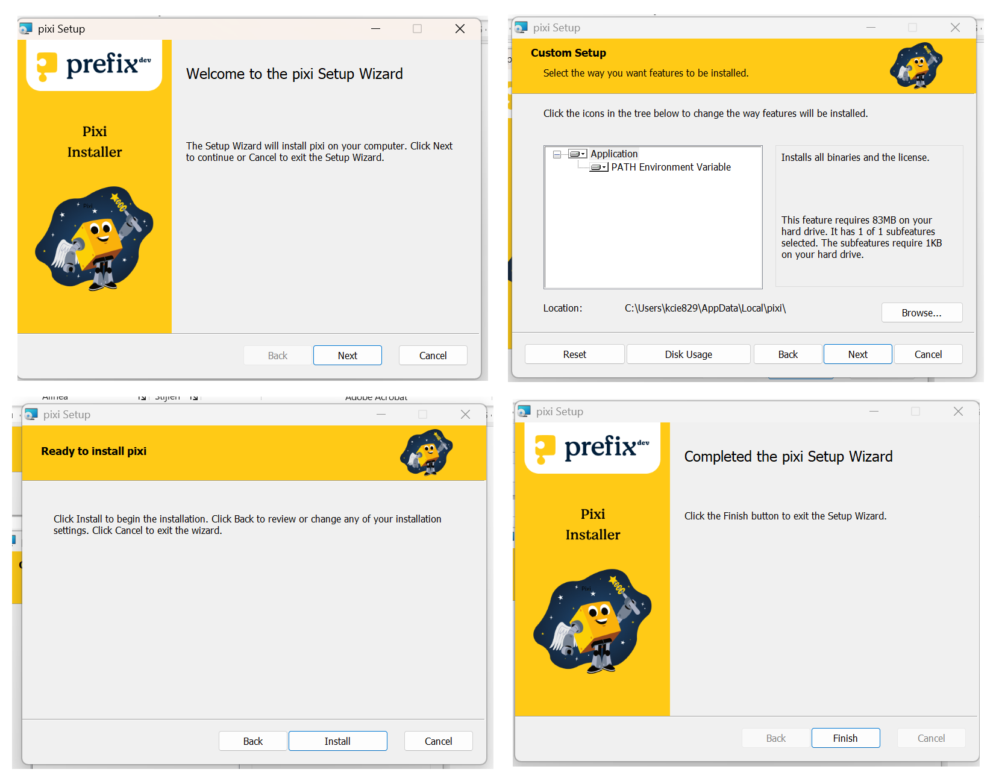
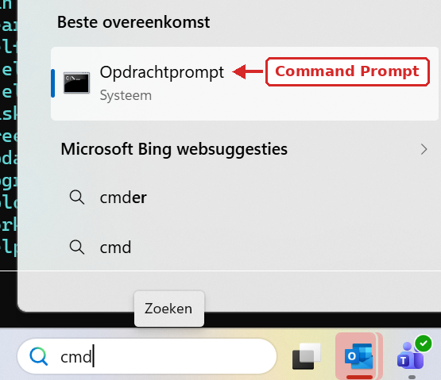

# Course setup

To get started, you should have the following three elements setup:

1. Download the course material to your computer
2. Install Python and the required Python packages using `pixi`
3. Test your configuration and installation
4. Start Jupyter lab

In the following sections, more details are provided for each of these steps. When all three are done, you are ready to start coding!

## 1. Getting the course materials

### Option 1: You are already a git user

As the course has been set up as a [git](https://git-scm.com/) repository managed on [Github](https://github.com/plovercode/DS-python-geospatial),
you can clone the entire course to your local machine. Use the command line to clone the repository and go into the course folder:

```
git clone https://github.com/plovercode/DS-python-geospatial.git
cd DS-python-geospatial
```

### Option 2: You are not a git user

To download the repository to your local machine as a zip-file, click the  `download ZIP` on the
repository page <https://github.com/plovercode/DS-python-geospatial> (green button "Code" -> "Download ZIP"):


After the download, unzip on the location you prefer within your user account (e.g. `My Documents`, not `C:\`). Watch out for a nested 'DS-python-geospatial/DS-python-geospatial' folder structure after unzipping and move the inner DS-python-geospatial folder to your preferred location.

__Note:__ Make sure you know where you stored the course material, e.g. `C:/Users/yourusername/Documents/DS-python-geospatial`.


## 2. Install Python and the required Python dependencies using `Pixi`

We recommend to use `Pixi`, a command line tool for package and environment management (<https://pixi.prefix.dev/latest/>).

`Pixi` allows us to install a Python distribution with the the scientific libraries we will use in this 
course (this recommendation applies to all platforms, so for both Windows, Linux and Mac).

### 2.1 Install `Pixi`

Go to the [installer page](https://pixi.prefix.dev/latest/installation/) and 
follow the installation instructions for your operating system.

For Windows users, accept the default installation guidelines:



### 2.2 Setup after `Pixi` installation

1. Open a terminal window. On Windows use "Command line" or "cmd", open it via Start Menu > 'Command line':

   

2. Navigate to the directory where you downloaded the course materials using the following command:

   ```
   cd FOLDER_PATH_TO_COURSE_MATERIAL
   ```

   __!__ `FOLDER_PATH_TO_COURSE_MATERIAL` should be replaced by the path to the
folder containing the downloaded course materials (e.g. in the example it is `C:/Users/yourusername/Documents/DS-python-geospatial`)

   Type the command and press `ENTER` to execute it. 

3. Create the environment and install the course dependencies:

   ```
   pixi install
   ```

   Type the command and press `ENTER` to execute it. 

Output will be printed and if no error occurs and you see `✔ The default environment has been installed.`, you have the environment configured with all packages installed. 
This may take a couple of minutes to download.

When finished, keep the terminal window open (or reopen it). Execute the following commands to check your installation:

```
pixi run ipython
```

Within the terminal, a Python session will be started in which you can start writing Python! Type the following command:

```
import pandas
import matplotlib
```

If no message is returned, you're all set! If a message (probably an error) returned, contact the instructors. Copy paste the message returned.

To get out of the Python session, type:

```
quit
```

__FAQ__ What if I get an error about not finding `pixi.toml`?

When you see the following error message after running `pixi install`:

```
Error:   × could not find pixi.toml or pyproject.toml with tool.pixi at directory ...
```

Then you are not running `pixi install` from the root of the course materials
directory. Check again where you downloaded the materials, and ensure you
navigate (`cd`) to the correct location (see step 2 above).

__FAQ__ What if I get a warning about outdated pixi version?

When you see the following message after running `pixi install`:
```
  ⚠ Lock-file version 7 is newer than supported
  help: Maximum supported version: 6 (pixi v0.67.0)
        The lock-file will be treated as missing and regenerated.
        Consider running `pixi self-update` to update to the latest version.
```

Stop the setup (CTRL-C), run the update `pixi self-update` command before doing the setup with `pixi install` again.


## 3. Test your configuration

To check if your packages are properly installed, open the terminal again (see above) and navigate to the course directory:

```
cd FOLDER_PATH_TO_COURSE_MATERIAL
```

With `FOLDER_PATH_TO_COURSE_MATERIAL` replaced by the path to the folder with the downloaded
course material (e.g. in the example it is `C:/Users/yourusername/Documents/DS-python-geospatial`).

Then, run the `check_environment.py` script:

```
pixi run python check_environment.py
```

When all checkmarks are ok, you're ready to go!


## 4.(_start of day during course_)  Starting Jupyter Notebook with Jupyter Lab

Each of the course modules is set up as a [Jupyter notebook](http://jupyter.org/), an interactive  environment to write and run code. It is no problem if you never used jupyter notebooks before as an introduction to notebooks is part of the course.


* In the terminal (or "Command Prompt"), navigate to the `DS-python-geospatial` directory (downloaded or cloned in the previous section)

  ```
  cd FOLDER_PATH_TO_COURSE_MATERIAL
  ```

* Start a jupyter notebook server by typing

  ```
  pixi run jupyter lab
  ```

## Next?

This will open a browser window automatically. Navigate to the course directory (if not already there) and choose the `notebooks` folder to access the individual notebooks containing the course material.